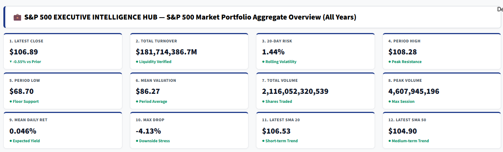
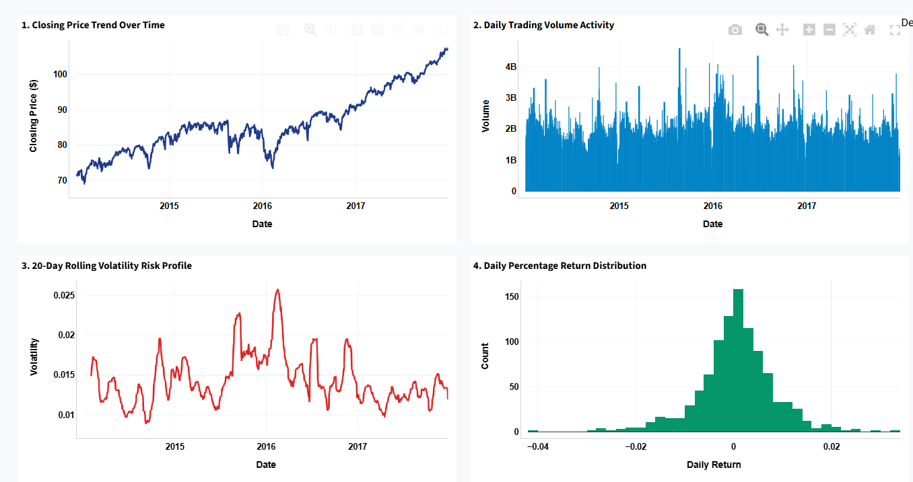
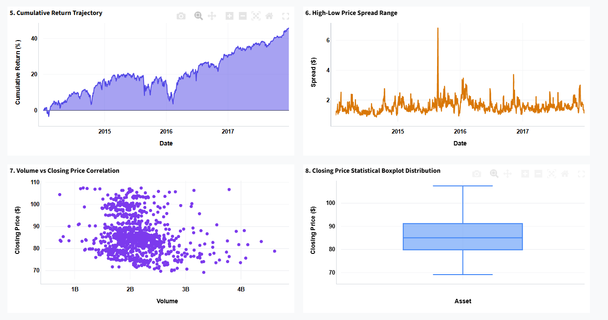
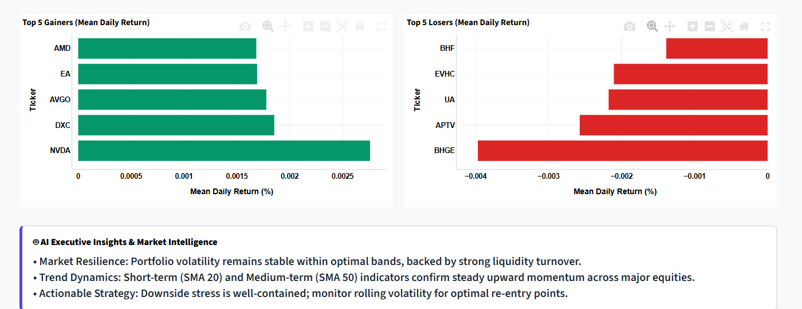

# S&P 500 Historical Data Dashboard

An independent Streamlit practice project for exploring historical stock price records. The dashboard reads the repository's processed CSV file; it does not fetch live market data and is not investment advice.

## Dashboard preview

Screenshots below show the repository's current dashboard output.

[Watch the recorded demo](assets/S%26P%20500%20demo.mp4)

## What it does

The app in app.py:

- Loads sp500_processed.csv and provides year and ticker filters.
- Shows 12 KPI cards and interactive Plotly charts for closing prices, volume, rolling volatility, daily returns, cumulative return, high-low spread, volume versus closing price, and closing-price distribution.
- Ranks symbols by mean daily return across the loaded dataset.

The “All Stocks” view computes unweighted averages across symbols for several daily measures and sums volume. It is an aggregate of the available records, not an official S&P 500 index series. The dashboard uses historical records and has no live market-data connection.

## KPI and interpretation notes

Some labels in the current app are broader than the formulas behind them:

- “Total Turnover” is calculated as the sum of close multiplied by volume; it is not independently verified as reported turnover.
- “Mean Daily Ret” is the arithmetic mean of the daily_return values, not an expected yield.
- “Max Drop” is the minimum single-period daily_return, not a peak-to-trough maximum drawdown.
- If the input does not contain cumulative_return, the app calculates a cumulative sum of daily returns. This is not compounded performance.
- The AI Insights panel currently contains fixed text in app.py; it is not generated by an AI model and should not be treated as a data-backed recommendation.

These notes describe the current implementation. The calculations and on-screen labels have not been changed in this documentation update.

## Data and provenance

The repository contains a source-named CSV file, S&P 500 Stock Prices 2014-2017.csv, and the processed file sp500_processed.csv. The README and code do not establish the original dataset publisher, source URL, license, or verified row and ticker counts. The filename suggests a 2014–2017 period, but exact coverage and counts have not been reconciled here.

Do not use the files for investment decisions. Before presenting dataset totals or market conclusions, document the dataset source and license and validate the CSV schema, date range, row count, and unique-symbol count.

## Project files

- app.py — Streamlit dashboard.
- preprocessing.py — prepares derived columns and writes a processed CSV. Review its output path before running so the existing dataset is not overwritten.
- model.py — separate Random Forest classification experiment. It is not called by the dashboard and does not produce the dashboard's insights.
- requirements.txt — dependencies listed for the dashboard. The separate model script imports scikit-learn, which is not currently listed here.

## Run the dashboard

Use Python and install the packages listed in requirements.txt:

~~~bash
git clone https://github.com/harshmeena9977-ops/sp500-financial-analytics.git
cd sp500-financial-analytics
python -m venv .venv
~~~

Activate the virtual environment for your operating system, then run:

~~~bash
python -m pip install -r requirements.txt
streamlit run app.py
~~~

The app expects sp500_processed.csv in the repository root. The dashboard setup above does not install the additional scikit-learn dependency required by the separate model experiment.
